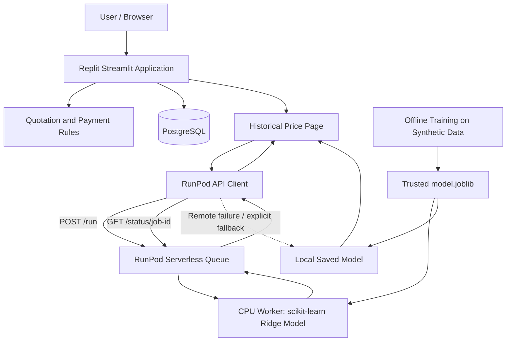

# SME Manufacturing Quotation Assistant

**An AI-assisted quotation decision-support prototype for small and medium-sized manufacturing enterprises.** Built for SDC Hackathon Domain 2, it combines production-cost analysis, historical transaction-price references, a remotely hosted prediction model, and a simulated quotation approval workflow. The system supports human decisions; it does not automatically determine optimal selling prices or guarantee profitability.

> **Demo disclaimer:** The included product, customer, transaction, inventory, and model-training data are synthetic. The application is a competition prototype, not a production financial or credit-risk system.

## Team Information

| Field | Details |
|---|---|
| **Team Name** | Nameless |
| **Team Domain** | Domain 2 |
| **SDG Track (1–17)** | SDG 9 — Industry, Innovation and Infrastructure |
| **SDG Target** | Target 9.3 — Improve small-scale enterprises' integration into value chains and markets |
| **Team Leader** | ZHANG XINRUI |
| **University** | Xiamen University Malaysia |
| **Number of Members** | 4 |
| **Other Team Members** | TODO — enter the remaining three members' names |

## Links

| Resource | Link |
|---|---|
| **GitHub Repository** | [The-Wildest-Dream/SDC-project](https://github.com/The-Wildest-Dream/SDC-project) |
| **Replit Project** | [SME-Quotation-Evaluation-System](https://replit.com/@realityfordream/SME-Quotation-Evaluation-System) |
| **Live Demo** | [SME Manufacturing Quotation Assistant](https://zhong-xiao-zhi-zao-qi-ye-bao-jie-fu-zhu-xi-tong.replit.app/) |
| **RunPod Endpoint** | https://api.runpod.ai/v2/4qbw60i5ghyhfo |
| **Slide Deck** | [**link**](https://xmueducn-my.sharepoint.com/:p:/g/personal/ait2609083_xmu_edu_my/IQDxgkpp6H8MQKdCOZ0hwFvVAWOll2I7Hi-Hdqj3-wUncDk?e=VYBUpr) |
| **Demo Video** | **TODO — add the YouTube pitch/demo video link** |

## Overview

### Problem

Small and medium-sized manufacturers must consider material costs, labor, overhead, delivery expenses, historical transaction prices, and customer payment terms when preparing quotations. Fragmented records and inconsistent procedures can make pricing decisions difficult to explain and review. Teams also need to retain the context of earlier quotations when costs change.

### Solution

The SME Manufacturing Quotation Assistant provides a unified Streamlit workflow for reviewing costs, historical transactions, price references, payment-term effects, and approval status. An offline-trained scikit-learn model estimates historical transaction unit prices. The application can request that estimate from a **RunPod Serverless CPU worker** and displays the prediction source transparently.

The model is an **additional decision reference**. Users retain control over proposed prices, and transparent quotation rules enforce minimum-margin checks.

### Key Features

1. **Cost-aware quotation support:** Material, labor, overhead, batch and delivery inputs; minimum-margin and target-margin calculations; saved cost snapshots.
2. **Historical price analysis:** Comparable transaction filters, price percentiles, and a synthetic-data-trained unit-price prediction model.
3. **RunPod remote inference:** Queue-based Serverless execution through a Python API client, with labeled local fallback when remote inference is unavailable.
4. **Payment-term analysis:** Prepayment, payment delay, and financing-cost calculations for quotation reference.
5. **Inventory and customer context:** Stock reminders and historical payment summaries as supplementary signals, not automated procurement or credit scoring.
6. **Simulated approval workflow:** Sales drafts, versioned quotations, manager approval/rejection, records, and audit-oriented logs.
7. **Data and exports:** PostgreSQL-backed business records, synthetic CSV import/export tools, quotation CSV export, and printable HTML.
8. **Multilingual interface:** Simplified Chinese, English, and Bahasa Melayu translation resources. **TODO — verify complete translation coverage in the final deployed demo.**

### Tech Stack

| Layer | Technology | Role |
|---|---|---|
| Frontend / application | Python 3.13, Streamlit | Interactive multipage quotation workflow |
| Business logic | Python modules | Cost rules, payment calculations, quote versioning and approvals |
| Database | PostgreSQL, SQLAlchemy, psycopg | Business records and workflow state |
| ML model | scikit-learn, pandas, joblib | Offline training and historical unit-price inference |
| AI / Compute | **RunPod Serverless (CPU, Queue mode)** | Remote inference using the saved model artifact |
| API integration | `runpod_client.py`, HTTPS / JSON | Submits jobs and polls results |
| Development / hosting | Replit, Replit Agent | Development, preview and deployed Streamlit app |
| Package management | `uv`, `pyproject.toml`, `uv.lock` | Reproducible Python dependency installation |

> **Compute disclosure:** The current model uses CPU-based scikit-learn Ridge regression, **not GPU-accelerated inference**. The official submission README gives a GPU workload as an example; **TODO — confirm with organizers whether this CPU deployment meets any separate GPU-specific eligibility requirement**.

## Project Structure

The following paths reflect this project's real repository layout rather than the template's example `src/main.py` layout.

```text
SDC-project/
├── app.py                         # Streamlit multipage entry point
├── *_page.py                      # Streamlit workflow pages
├── history_page.py                # Historical pricing and RunPod integration
├── runpod_client.py               # RunPod API submission, polling and fallback
├── runpod/
│   ├── Dockerfile                 # Worker image; build context is repository root
│   ├── handler.py                 # RunPod Serverless handler
│   ├── requirements.txt           # Worker dependencies
│   ├── test_input.json            # Example inference request
│   └── README.md                  # RunPod setup and usage guide
├── price_model.py                 # Shared prediction and applicability logic
├── train_price_model.py           # Offline training
├── models/historical_price/       # Trusted model artifact and evaluation
├── quotation_rules.py            # Quotation calculations and checks
├── finance_rules.py              # Financing and payment-term calculations
├── inquiry_service.py            # Inquiry logic
├── workflow_service.py           # Quotation workflow logic
├── payment_service.py            # Payment-related service logic
├── database.py                    # Database access
├── db_schema.py                   # Database schema
├── data_service.py                # Data import/validation logic
├── generate_data.py               # Reproducible synthetic data
├── sample_data/                   # Sample CSV files
├── locales/                       # zh-CN, en and ms resources
├── i18n.py                        # Localization helpers
├── tests/                         # Automated tests, including RunPod integration tests
├── db_manage.py                   # Development database management
├── verify_database.py             # Database verification
├── verify_workflow.py             # Workflow verification
├── start.sh                       # Streamlit launch script
├── .replit                        # Replit configuration
├── pyproject.toml                 # Python dependencies
├── uv.lock                        # Locked Python dependencies
├── DATA_GUIDE.md
├── DATABASE_GUIDE.md
├── MODEL_GUIDE.md
├── QUOTATION_GUIDE.md
├── WORKFLOW_GUIDE.md
├── LICENSE                        # Apache License 2.0
└── README.md
```

The repository also includes React/Vite and workspace scaffolding. The quotation application itself runs as a Python Streamlit application.

**Submission directory:** **TODO — create `submission/` and add the completed required PDF files before final submission.**

### Architecture



**Data boundary:** The RunPod Worker receives only model input fields (product ID, currency, unit, quantity, unit cost, and date). The Worker does not connect directly to PostgreSQL and does not need database credentials. The saved model artifact is packaged into the Docker image.

## How to Run

### Option 1 — Run on Replit (Recommended)

1. Open the [Replit project](https://replit.com/@realityfordream/SME-Quotation-Evaluation-System).
2. Configure the Replit database and application environment.
3. Add the following **Secrets** in Replit (never put real values in GitHub):

   | Secret | Purpose |
   |---|---|
   | `DATABASE_URL` | PostgreSQL connection string |
   | `RUNPOD_API_KEY` | RunPod API credential |
   | `RUNPOD_ENDPOINT_ID` | ID of the deployed RunPod Serverless Endpoint |

4. Start the existing Replit workflow / Streamlit application.
5. Open the application preview or the [published demo](https://zhong-xiao-zhi-zao-qi-ye-bao-jie-fu-zhu-xi-tong.replit.app/).
6. For the published deployment, confirm that the deployment environment also has access to the required Secrets; **republish** after code changes when necessary.

If RunPod is not configured or is temporarily unavailable, the historical price page may use the local model fallback and labels its prediction source accordingly.

### Option 2 — Run Locally

Prerequisites: Python 3.13, `uv`, and a development PostgreSQL database.

```bash
git clone https://github.com/The-Wildest-Dream/SDC-project.git
cd SDC-project
uv sync --frozen
```

Configure `DATABASE_URL`, `RUNPOD_API_KEY`, and `RUNPOD_ENDPOINT_ID` in your local environment or a securely managed, untracked environment configuration. **Do not commit credentials.**

For a **new development database only**, run:

```bash
python db_manage.py check
python db_manage.py init
python db_manage.py seed
python db_manage.py counts
sh start.sh
```

`init` creates missing tables; `seed` adds missing synthetic records. These commands should not be used to reset shared or production data. `start.sh` runs Streamlit on `PORT` (default `3000`).

### Run Tests

```bash
python -m unittest discover -s tests -v
```

Additional development checks:

```bash
python verify_database.py
python verify_workflow.py
```

These checks require suitable database configuration and may create demonstration records. Review their effects before running against a shared database.

## Demo Walkthrough

1. Launch the Streamlit application and choose a simulated Sales role. The role selector is not user authentication.
2. Open **New Inquiry & Costing**. Choose a customer and product, inspect the cost breakdown, and save an inquiry.
3. Open **Historical Prices & Quote Guidance**. Compare synthetic historical transactions and review the model estimate, cost floor, and payment-term effects.
4. Check the **prediction source** indicator: RunPod remote inference, local model fallback, or unavailable.
5. Enter a manually proposed quotation price and save a draft.
6. Open **Quote Records & Downloads** and submit the saved version for approval.
7. Switch to the simulated Manager role and approve or reject the quotation with a comment.
8. Return to records and export the saved quotation as CSV or printable HTML.

**TODO — confirm the final demo sequence, screenshots, and displayed page titles against the published application.**

## AI Model and Evaluation

### Objective and Method

The model estimates **historical transaction unit prices**, not purchase probability, customer trustworthiness, an optimal-profit selling price, or a guaranteed market quote.

The saved artifact contains separate `StandardScaler + Ridge(alpha=1)` pipelines by **product / currency / unit** group. Numeric input features are:

- Quantity
- Historical unit cost
- Ordinal transaction date
- Month

The artifact was trained offline using fixed-seed synthetic transactions generated by `generate_data.generate()`. Imported business data and newly created inquiries do **not** automatically retrain the model.

### Evaluation

The committed evaluation artifact (`models/historical_price/evaluation.json`) reports:

| Measure | Recorded result |
|---|---|
| Training records | 239 |
| Held-out test records | 61 |
| Split date | 2026-08-13 |
| Split method | Chronological, keeping same-day records together |
| Baseline | Training-set median transaction price for each group |
| Metric | Mean Absolute Error (MAE) |
| Product groups | 6 |
| Groups with lower model MAE than baseline | 4 of 6 |
| Groups without improvement | P001 and P005 |

These results evaluate behavior on **synthetic data only**. They do not establish real-world pricing accuracy or business impact. Detailed per-group metrics and applicability ranges are available in [MODEL_GUIDE.md](MODEL_GUIDE.md) and the evaluation JSON.

### Applicability and Human Control

Predictions may be unavailable for unsupported product/currency/unit combinations, missing cost information, insufficient data, or out-of-range inputs. The application retains cost and historical-statistics references where available. Model estimates do not automatically override manually proposed prices or the minimum-margin floor.

## How We Use Replit (Required)

- **Development:** Replit and Replit Agent were used to implement, iterate on, and debug the Python Streamlit quotation workflow.
- **Application hosting:** Replit hosts the Streamlit application and provides the published demonstration URL.
- **Database:** The application connects to PostgreSQL through the runtime `DATABASE_URL`.
- **Secrets management:** `RUNPOD_API_KEY`, `RUNPOD_ENDPOINT_ID`, and database credentials are configured through environment Secrets rather than committed source code.
- **Integration:** The Streamlit historical-price page invokes `runpod_client.py` when it needs a model prediction.
- **Deployment:** Changes to the live application require verification and, when appropriate, a new Replit publication.

**Proof of Use:** **TODO — create and link** `submission/SDC2026_Nameless_Replit_POU.pdf`, including development/hosting evidence and screenshots with credentials redacted.

## How We Use RunPod (Required)
- **Endpoint Name:** SDC-project
- **Endpoint ID:** `4qbw60i5ghyhfo`
- **Endpoint URL:** https://api.runpod.ai/v2/4qbw60i5ghyhfo
- **Endpoint Type:** Queue-based Serverless
- **Compute:** CPU
### Workload

RunPod Serverless hosts **CPU-based inference** for the existing historical transaction-price model. It loads the trusted `models/historical_price/model.joblib` artifact and reuses the project's prediction logic. The worker does **not** retrain the model, implement a second pricing algorithm, or connect to the application database.

### Deployment

- **Service:** RunPod Serverless, **Queue** endpoint.
- **Source:** This GitHub repository.
- **Dockerfile:** `runpod/Dockerfile`, built using the **repository root** as context.
- **Worker entry point:** `runpod/handler.py`, which calls `runpod.serverless.start(...)`.
- **Compute:** CPU, not GPU.
- **Endpoint name:** `SDC-project`.
- **Endpoint ID / URL:** **TODO — add actual Endpoint ID and URL**.
- **Configuration:** **TODO — confirm and document final CPU size, maximum workers, active workers, and execution timeout from the RunPod dashboard.**

### API Integration

The Streamlit historical-price page calls `runpod_client.predict_price(...)`. The client:

1. Sends a JSON request to `POST https://api.runpod.ai/v2/<ENDPOINT_ID>/run`.
2. Polls `GET https://api.runpod.ai/v2/<ENDPOINT_ID>/status/<JOB_ID>` while the job is queued or running.
3. Reads the worker's prediction and metadata after successful completion.
4. Labels the result as `runpod`, `local_fallback`, or `unavailable`.

The current page enables an explicitly labeled local fallback if the remote request fails. For a strict remote verification, use `allow_local_fallback=False` in a controlled test.

### Example Request

```json
{
  "input": {
    "product": "P001",
    "currency": "CNY",
    "unit": "件",
    "quantity": 100,
    "cost": 50,
    "day": "2026-10-23"
  }
}
```

This example matches the checked-in test input. It is **not** a real Malaysian market transaction.

### Verification and Evidence

A manual RunPod dashboard request was reported successful during setup. The repository also includes integration tests that mock API responses; mocked tests alone do not prove a live deployment is reachable.

**TODO — attach and verify evidence for all of the following:**

- RunPod Endpoint in **Ready** state.
- Successful Docker build.
- Completed inference request with the output visible.
- Replit application showing **RunPod remote inference** as the prediction source.
- A corresponding new request in the RunPod dashboard from the Replit application.
- Final production deployment confirmation.

**Proof of Use:** **TODO — create and link** `submission/SDC2026_Nameless_Runpod_POU.pdf`. Redact all API keys and credentials in screenshots.

> **Organizer clarification needed:** The official README template illustrates GPU inference. This implementation uses CPU inference; **TODO — confirm acceptance of CPU RunPod Serverless use if the competition separately requires GPU compute**.

## Data, Privacy and Security

The project uses reproducible synthetic sample data for its demonstration and offline model training. Valid business records entered through the app may be stored in PostgreSQL. The code does not claim automatic data deletion, production-grade encryption, or certified privacy compliance.

The Sales and Manager roles are simulated workflow controls, **not authenticated identities**. The application is not a production authorization system.

RunPod requests contain the model's input features rather than complete database records. API keys and database credentials must remain in environment Secrets and must never be included in the README, source control, screenshots, or client-side UI.

## Testing and Verification

Repository tests cover calculation rules, data validation, model behavior, and RunPod client/worker integration scenarios. The RunPod integration tests use mocked HTTP responses and the existing trusted local model artifact; they are not a substitute for a live endpoint test.

The available commands are:

```bash
python -m unittest discover -s tests -v
python verify_database.py
python verify_workflow.py
```

**Verification status:**

| Check | Status |
|---|---|
| RunPod Worker and client code present | Verified in repository |
| Historical-price page imports RunPod client | Verified in repository |
| Three-language prediction-source labels | Verified in repository |
| RunPod manual request | Reported successful during setup |
| Latest full automated test suite | **TODO — record dated test run and results** |
| Live Replit-to-RunPod end-to-end test | **TODO — record screenshot and corresponding RunPod request** |
| Published website on latest code | **TODO — verify after Republish** |
| Full quotation and approval walkthrough | **TODO — complete and record results** |

## Challenges & Learnings

- **Deploying an existing ML model remotely:** The team reused a saved scikit-learn artifact rather than creating an unrelated AI model merely to demonstrate infrastructure.
- **Asynchronous inference:** RunPod Queue requests require job submission and status polling; the Replit client handles both.
- **Resilience and transparency:** The application labels local fallback rather than presenting every estimate as remote inference.
- **Cost-conscious compute:** CPU execution fits the current Ridge regression workload. GPU acceleration is not claimed.
- **Synthetic-data boundaries:** The team separated prototype model evaluation from real-world business claims.
- **Multilingual UX and workflow state:** The application maintains translation resources and versioned quotation snapshots across multiple pages.

**TODO — add any other team-specific development challenges and verified lessons from testing.**

## Future Improvements

- [ ] Validate the approach using permissioned real manufacturing transaction data, including appropriate Malaysian product, currency, and unit coverage.
- [ ] Retrain and benchmark models on representative data; compare against simple baselines and evaluate calibration/robustness.
- [ ] Improve full Simplified Chinese, English, and Bahasa Melayu translation coverage.
- [ ] Introduce authenticated user accounts and production-grade role-based access control.
- [ ] Complete partial-payment ledger import, reconciliation, and reporting.
- [ ] Expand configurable quotation policy controls and audit reporting.
- [ ] Improve inference observability, error monitoring, and deployment verification.
- [ ] Investigate more advanced forecasting or optimization only when supported by sufficient data and proper evaluation.

## Team

| Member | Role | GitHub |
|---|---|---|
| ZHANG XINRUI | **TODO — confirm team responsibilities** | **TODO — confirm personal GitHub profile** |
| **TODO — Member 2** | **TODO — role** | **TODO — GitHub** |
| **TODO — Member 3** | **TODO — role** | **TODO — GitHub** |
| **TODO — Member 4** | **TODO — role** | **TODO — GitHub** |

## AI-Assisted Development and Third-Party Resources

Replit Agent was used to assist with application implementation and debugging. ChatGPT was used for requirements discussion, documentation drafting, translation support, and technical guidance. The team remains responsible for reviewing generated work and verifying submitted claims.

Core Python dependencies are declared in `pyproject.toml` and locked in `uv.lock`. Their respective upstream licenses remain applicable. The project repository's Apache 2.0 license does not replace third-party license obligations.

## Submission Checklist

The following follows the [official SDC Hackathon submission README template](https://github.com/michaelzhngg/SDC_Hackathon_Submission_Template). The official submission documents are provided through the template's linked Google Drive folder.

- [x] Team name, domain, SDG track and university listed in this README (**TODO — cross-check registration**).
- [x] GitHub repository and live demo links listed.
- [x] Root Apache License 2.0 `LICENSE` file present.
- [x] RunPod integration code and dedicated RunPod documentation present.
- [ ] **TODO — confirm repository is public and accessible to judges.**
- [ ] **TODO — add final RunPod Endpoint ID / URL.**
- [ ] **TODO — add slide deck link.**
- [ ] **TODO — add YouTube demo/pitch video link.**
- [ ] **TODO — add `submission/SDC2026_Nameless_Preliminary.pdf`.**
- [ ] **TODO — add `submission/SDC2026_Nameless_TechDeclaration.pdf`.**
- [ ] **TODO — add `submission/SDC2026_Nameless_Replit_POU.pdf`.**
- [ ] **TODO — add `submission/SDC2026_Nameless_Runpod_POU.pdf`.**
- [ ] **TODO — verify all required signatures, team details, and technology disclosures.**
- [ ] **TODO — verify RunPod CPU deployment satisfies the organizer's requirements.**
- [ ] **TODO — test published Replit-to-RunPod inference and preserve proof.**
- [ ] **TODO — verify the full demonstration and all public links.**
- [ ] **TODO — ensure no secrets or credentials are committed.**
- [ ] **TODO — complete official submission through the designated platform.**

The existence of a README or a working demo does not mean the formal competition submission is complete.

## License

This project is licensed under the [Apache License 2.0](LICENSE).
