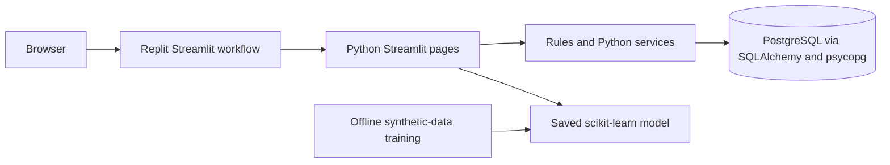

# SME Manufacturing Quotation Assistant

A Python and Streamlit demonstration application for small and medium-sized manufacturers. It supports **price analysis and quotation decisions** by combining product costs, synthetic transaction history, quotation rules, payment terms, and a simulated approval workflow. Inventory and customer payment information are supplementary signals only. The application does not guarantee optimal profit or assess a customer's integrity.

## Team Information

| Item | Information |
|---|---|
| Team Name | Nameless |
| Domain | Domain 2 |
| SDG Track and Target | TODO — not confirmed |
| Team Leader | ZHANG XINRUI |
| University Affiliation(s) | XIAMEN UNIVERSITY MALAYSIA |
| Number of Members | 4 |

| Name | Role and Contribution | GitHub |
|---|---|---|
| TODO | TODO | TODO |

## Project Links

| Resource | Link / Status |
|---|---|
| GitHub Repository | [The-Wildest-Dream/SDC-project](https://github.com/The-Wildest-Dream/SDC-project) |
| Replit Project | TODO — provide the canonical project URL |
| Live Demo | TODO — provide a published application URL |
| Slide Deck | TODO |
| YouTube Pitch / Demo Video | TODO |
| RunPod Endpoint | Not used by this application; confirm whether the competition requires one |

The repository is known from the submitted project information. Other links are not inferred from a development preview URL.

## Problem and Solution

Small manufacturers may need to reconcile material, labor, overhead, batch charges, delivery costs, prior transaction prices, payment terms, and approval steps when preparing a quote. This demo gives sales staff and managers a single workflow for reviewing those inputs. It stores snapshots with quote versions so that later product-cost changes do not rewrite an already saved quote.

The target users are manufacturing sales staff and managers in a simulated competition workflow. Human staff enter the final proposed price; the simulated manager makes the approval decision. Historical statistics and model predictions are references, not automatic decisions.

The application includes a scikit-learn regression prototype that predicts historical transaction unit prices. Transparent rules calculate cost floors and financing costs. The model does not predict purchase probability or an optimal-profit price.

## Implemented Features

Implementation claims below describe repository code; they are not all claims of end-to-end production validation.

- Synthetic product, customer, transaction, and inventory data; reproducible generator and CSV viewing, validation, import, and export.
- Inquiry creation, cost snapshots, target and minimum margin calculations.
- Comparable historical price statistics and a saved offline historical transaction-price model.
- Payment-term and financing-cost calculations plus rule-based validity suggestions in the inquiry flow. These are demonstration inputs and rules, not a persistent manager-managed policy system.
- Customer payment summaries based on legacy whole-order payment dates. A payment-ledger table and service code exist, but an integrated partial-payment import and reporting workflow is not complete.
- Inventory availability reminders; they do not trigger purchasing or promise delivery.
- Simulated sales/manager quote workflow, version snapshots, approval records, and operation logs.
- CSV and printable HTML quote exports.
- A session-scoped language selector and static resources for Simplified Chinese, English, and Bahasa Melayu. The project is shown in Chinese originally.

## Demo Walkthrough

Prerequisites: Python 3.13 as declared in `pyproject.toml`, the dependencies in `requirements.txt`, and a PostgreSQL `DATABASE_URL`.

1. Initialize a development database and load the synthetic demo data as described in [Setup and Run](#setup--run).
2. Start the Streamlit application and choose a demo role in the sidebar. Role switching is not authentication or production-grade authorization.
3. Open **New Inquiry & Costing** (the page title may currently be localized or partly untranslated). Select a customer and product; review the cost and payment-term inputs, then save the inquiry.
4. Open **Historical Prices & Quote Guidance**. Review comparable transactions, the model reference when available, cost floor, and manually proposed quote. Save a quote draft.
5. Open **Quote Records & Downloads** and submit the sales-owned draft for approval.
6. Switch to the simulated Manager role, open **Approvals**, enter an approval comment, and approve or reject the pending version.
7. Return to quote records and download the saved version as CSV or printable HTML.

The role selector is a demonstration control only. It is not proof of a user's identity.

## Architecture and Technology

- Python 3.13, Streamlit, SQLAlchemy, psycopg 3, PostgreSQL.
- scikit-learn, pandas, and joblib for offline training, evaluation, and model loading.
- `app.py` is the Streamlit multipage entry point; page modules call Python services and rule functions.
- PostgreSQL stores business data; `DATABASE_URL` is read from the runtime environment.
- `train_price_model.py` generates the model artifact offline. The app loads the artifact; it does not train on page refresh.
- Replit runs the Streamlit app through `start.sh` on `PORT` (default 3000).

The repository also contains React/Vite and API-server template artifacts. They are not the quotation application's runtime architecture. No RunPod endpoint is used.



## Repository Structure

| Path | Purpose |
|---|---|
| `app.py`, `*_page.py` | Streamlit entry point and page modules |
| `quotation_rules.py`, `finance_rules.py`, `inquiry_service.py`, `workflow_service.py`, `payment_service.py` | Cost, payment, inquiry, and quote workflow logic |
| `database.py`, `db_schema.py`, `data_service.py`, `shared_data.py` | PostgreSQL schema, connection, CSV validation, and shared data access |
| `generate_data.py`, `sample_data/` | Fixed-seed synthetic data generator and sample CSVs |
| `train_price_model.py`, `price_model.py`, `models/historical_price/` | Offline model training, prediction, and evaluation artifact |
| `locales/`, `i18n.py` | Static translation resources and session language helper |
| `tests/`, `verify_database.py`, `verify_workflow.py` | Unit and manual database workflow checks |
| `DATA_GUIDE.md`, `DATABASE_GUIDE.md`, `MODEL_GUIDE.md`, `QUOTATION_GUIDE.md`, `WORKFLOW_GUIDE.md` | Technical guides |
| `submission/` | Missing; required signed PDFs and evidence have not been supplied |
| `artifacts/quotation/` | Replit artifact directory containing preview scaffold files; app launch uses root `start.sh` |

## Setup and Run

Install Python 3.13 and project dependencies:

```bash
python -m pip install -r requirements.txt
```

Configure `DATABASE_URL` using the Replit database/environment configuration. Do not place credentials in source files, README, or logs. Then, in a **development** environment:

```bash
python db_manage.py check
python db_manage.py init
python db_manage.py seed
python db_manage.py counts
sh start.sh
```

`init` creates missing tables only; it does not clear or rebuild existing data. `seed` adds missing synthetic master/transaction records and is intended to be repeatable. Do not repeatedly reset or clear the database. `migrate_legacy_quotes.py` is a separate development-only compatibility utility; do not run it in production.

The Streamlit service listens on `PORT`, defaulting to `3000`. In Replit, start the configured `artifacts/quotation: web` workflow and use its Preview. The canonical Replit project and published URL remain TODO in the project links.

## AI Model and Evaluation

The saved model predicts **historical transaction unit price**. It uses separate `StandardScaler + Ridge(alpha=1)` pipelines for each product/currency/unit group. Numeric features are quantity, historical unit cost, ordinal date, and month; product/currency/unit select a group. Actual payment dates and transaction price are not input features.

Training uses only the fixed-seed synthetic trades produced by `generate_data.generate()`, not database uploads. Records are sorted by date and order ID, then split chronologically; same-day records remain together. The preprocessing pipeline is fitted on training data only. The baseline is the training-set median price for the same group, compared with the model on the same held-out test records using MAE.

The committed evaluation artifact reports a split date of 2026-08-13 (239 training and 61 test records). Four of six product groups have lower model MAE than the baseline; P001 and P005 do not. See [MODEL_GUIDE.md](MODEL_GUIDE.md) and `models/historical_price/evaluation.json` for per-group values and ranges. Synthetic-data metrics validate only the prototype workflow and do not demonstrate real commercial benefit.

The app falls back to cost and historical references when a model is missing, a group has insufficient data, or inputs are out of range. Re-train explicitly with `python train_price_model.py`; uploaded data does not enter training automatically. The generated `joblib` artifact is loaded at runtime and should only be loaded from a trusted project build.

## Data and Privacy

The generator uses a fixed random seed to create synthetic products, customers, transactions, and inventory. Its rules and CSV contracts are documented in [DATA_GUIDE.md](DATA_GUIDE.md). Valid imported business data is stored in PostgreSQL. This repository does not claim automatic deletion or encryption beyond the platform/database configuration.

The sales and manager roles are simulated values used for workflow demonstration. Backend business functions also validate role codes and quote states, but there is no real user authentication or production-grade access-control system. Database credentials are obtained from `DATABASE_URL` at runtime and are not included here.

## Testing and Verification

Commands available in the repository:

```bash
python -m unittest discover -s tests -v
python verify_database.py
python verify_workflow.py
```

The unit suite covers calculation, data validation, and model behavior. The database verification script requires a configured development PostgreSQL database and performs transactional checks. The workflow verification script creates synthetic demonstration quote records; review its behavior before running against a shared database.

For this documentation-only change, repository links and document inventory are checked. **Not run:** unit tests, database verification, and interactive approval flow; this change does not modify application code. Prior recorded model evaluation is described above, not rerun as part of this documentation update.

## Replit, RunPod, and Sponsor Resources

The repository is configured to run the Streamlit app in a Replit workflow and declares an Autoscale deployment target. This confirms project configuration, not a currently published or competition-accessible production URL. RunPod is not used in the application; confirm whether a RunPod endpoint or usage evidence is required by the competition. No sponsor-credit usage evidence is present in the repository.

## AI-Assisted Development and Third-Party Resources

Replit Agent was used in this workspace for implementation and documentation assistance. ChatGPT and other tools: TODO — team confirmation required. Human review/sign-off of every generated or translated section: TODO — team confirmation required.

Runtime dependencies listed in `requirements.txt` include Streamlit, SQLAlchemy, psycopg, scikit-learn, joblib, and pandas. Exact package versions are listed in that file. Their individual license notices have not been independently inventoried here; retain third-party notices and consult package metadata before redistribution.

## Known Limitations and Future Improvements

- All supplied transaction and business data are synthetic. Model performance on them does not establish real-world accuracy or commercial impact.
- The model does not beat its baseline for every product group and falls back outside its supported ranges.
- Simulated role selection is not identity authentication or production authorization.
- The payment-ledger schema/service is not yet connected to a complete partial-payment import and analysis UI; current customer summaries rely on whole-order payment dates.
- Validity inputs/rules are demonstration-level and are not managed through a durable manager policy screen.
- The three-language selector and static resources are present, but translation coverage is incomplete and some strings fall back to Chinese.
- Competition identity, SDG target, published links, signatures, and sponsor evidence remain unconfirmed.

## Submission Materials and Checklist

Required file names use the official team name, which is currently **TODO**. No submission PDFs were found:

| Material | Status |
|---|---|
| `submission/SDC2026_<TeamName>_Preliminary.pdf` | Missing |
| `submission/SDC2026_<TeamName>_TechDeclaration.pdf` | Missing |
| `submission/SDC2026_<TeamName>_Replit_POU.pdf` | Missing |
| RunPod usage evidence | Missing / requirement applicability to confirm; RunPod is not used by the app |
| Slide deck | Missing / link TODO |
| 5–7 minute YouTube video | Missing / link TODO |
| Published prototype URL | TODO |

Submission checklist (not verified):

- [ ] Official team name and all member details confirmed.
- [ ] Repository visibility is Public.
- [ ] Root Apache 2.0 `LICENSE` is present.
- [ ] Committee-designated account can access the project.
- [ ] All project and submission links are accessible.
- [ ] Technical declaration and signatures are complete.
- [ ] Official website submission is complete.
- [ ] RunPod requirement and any required evidence are confirmed.

Completing this README does not mean the competition submission is complete.

## License

This project is licensed under the Apache License 2.0.
See the [LICENSE](LICENSE) file for details.
