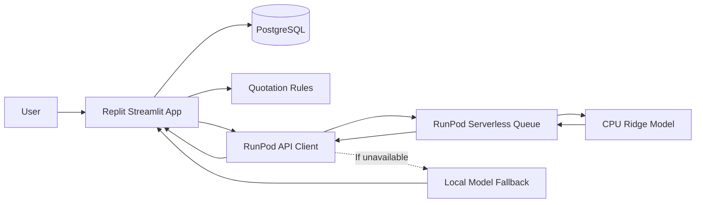

# SME Manufacturing Quotation Assistant

An AI-assisted quotation decision-support application for small and medium-sized manufacturers, developed for **SDC Hackathon 2026 — Domain 2**. It combines cost-based pricing, historical transaction analysis, RunPod-hosted model inference, and a simulated quotation approval workflow.

> **Prototype notice:** The included demonstration data and model-training records are synthetic. Predictions are supporting references, not guaranteed market prices, automatic profit optimization, or customer credit scores.

## Team Information

| Field | Details |
|---|---|
| Team Name | Nameless |
| Team Domain | Domain 2 |
| SDG Track | SDG 9 — Industry, Innovation and Infrastructure |
| SDG Target | 9.3 — Support small enterprises' access to value chains and markets |
| Team Leader | ZHANG XINRUI |
| University | Xiamen University Malaysia |
| Number of Members | 4 |

## Links

| Resource | Link |
|---|---|
| GitHub Repository | [The-Wildest-Dream/SDC-project](https://github.com/The-Wildest-Dream/SDC-project) |
| Replit Project | [SME-Quotation-Evaluation-System](https://replit.com/@realityfordream/SME-Quotation-Evaluation-System) |
| Live Demo | [Open application](https://zhong-xiao-zhi-zao-qi-ye-bao-jie-fu-zhu-xi-tong.replit.app/) |
| RunPod Endpoint | [RunPod API endpoint](https://api.runpod.ai/v2/4qbw60i5ghyhfo) |
| Slide Deck | [Presentation](https://xmueducn-my.sharepoint.com/:p:/g/personal/ait2609083_xmu_edu_my/IQDxgkpp6H8MQKdCOZ0hwFvVAWOll2I7Hi-Hdqj3-wUncDk?e=VYBUpr) |
| Demo Video | **TODO — add YouTube video URL** |

## Overview

### Problem

Manufacturing SMEs must combine production costs, historical selling prices, delivery charges, and payment terms when preparing quotations. Disconnected records and inconsistent review procedures can make quotations difficult to explain, compare, and approve.

### Solution

Our Streamlit application brings these steps into a single workflow. It calculates quotation cost floors, displays comparable historical prices, and offers an ML-based estimate of historical transaction unit prices through a **RunPod Serverless CPU endpoint**. Sales staff retain control of proposed prices; managers review quotations through a simulated approval process.

### Key Features

- **Cost-based quotation:** Material, labor, overhead, additional costs, minimum margin, and target margin.
- **Historical price guidance:** Comparable transactions, price percentiles, and Ridge-regression estimates.
- **RunPod inference:** Remote prediction with a clearly labeled local-model fallback.
- **Payment and inventory context:** Financing-cost estimates, historical payment summaries, and stock reminders.
- **Quotation workflow:** Drafts, version history, simulated manager approval, logs, and CSV/printable HTML exports.
- **Data and languages:** PostgreSQL storage, synthetic CSV data tools, and Chinese/English/Malay language resources.

### Tech Stack

| Layer | Technology |
|---|---|
| Application / UI | Python 3.13, Streamlit |
| Business logic | Python quotation and payment services |
| Database | PostgreSQL, SQLAlchemy, psycopg |
| ML | scikit-learn (StandardScaler + Ridge), pandas, joblib |
| Remote inference | RunPod Serverless **CPU**, Queue endpoint |
| Hosting and development | Replit, Replit Agent |
| Dependencies | `pyproject.toml`, `uv.lock` |

## Project Structure

```text
SDC-project/
├── app.py                       # Streamlit entry point
├── *_page.py                    # Workflow pages
├── history_page.py              # Historical analysis and remote prediction
├── runpod_client.py             # RunPod API client and fallback
├── runpod/
│   ├── handler.py               # Serverless worker
│   ├── Dockerfile               # Worker image
│   ├── requirements.txt
│   ├── test_input.json
│   └── README.md
├── price_model.py               # Model inference logic
├── train_price_model.py         # Offline training
├── models/historical_price/     # Model artifact and evaluation
├── quotation_rules.py           # Pricing rules
├── finance_rules.py             # Payment/financing calculations
├── *_service.py                 # Data and business services
├── database.py
├── db_schema.py
├── generate_data.py
├── sample_data/
├── locales/                     # Chinese, English, Malay resources
├── i18n.py
├── tests/
├── start.sh
├── pyproject.toml
├── uv.lock
├── .replit
├── LICENSE
└── README.md
```

The repository also contains auxiliary workspace/frontend scaffolding; the quotation app runs through Streamlit.

### Architecture



## How to Run

### Option 1 — Replit

1. Open the [Replit project](https://replit.com/@realityfordream/SME-Quotation-Evaluation-System).
2. Configure PostgreSQL and the following Replit Secrets:
   - `DATABASE_URL` — PostgreSQL connection.
   - `RUNPOD_API_KEY` — RunPod API credential.
   - `RUNPOD_ENDPOINT_ID` — `4qbw60i5ghyhfo`.
3. Start the existing application workflow and open Preview. The published application is linked above.
4. When publishing changes, confirm that deployment Secrets are available and republish as needed.

### Option 2 — Local Development

Requires Python 3.13, `uv`, and a development PostgreSQL database.

```bash
git clone https://github.com/The-Wildest-Dream/SDC-project.git
cd SDC-project
uv sync --frozen
```

Set `DATABASE_URL`, `RUNPOD_API_KEY`, and `RUNPOD_ENDPOINT_ID` in the runtime environment. For a new **development** database:

```bash
python db_manage.py check
python db_manage.py init
python db_manage.py seed
sh start.sh
```

The Streamlit server uses `PORT` (default `3000`). Do not run development seeding or workflow verification scripts against production data without reviewing their effects.

### Run Tests

```bash
python -m unittest discover -s tests -v
```

Database and workflow verification scripts are also provided: `verify_database.py` and `verify_workflow.py`.

## How We Use Replit (Required)

- **Development:** Replit and Replit Agent supported implementation, iteration, and debugging.
- **Hosting:** The Streamlit quotation application is deployed using Replit.
- **Data and configuration:** PostgreSQL connects through `DATABASE_URL`; sensitive credentials are managed through Replit Secrets.
- **Integration:** The historical-price page uses `runpod_client.py` to request remote predictions.

**Proof of Use:** **TODO — attach `SDC2026_Nameless_Replit_POU.pdf` using the official submission process.**

## How We Use RunPod (Required)

- **Endpoint:** `SDC-project` — [https://api.runpod.ai/v2/4qbw60i5ghyhfo](https://api.runpod.ai/v2/4qbw60i5ghyhfo).
- **Compute:** RunPod Serverless **CPU**, Queue based. No GPU use is claimed.
- **Worker:** `runpod/handler.py`, packaged using `runpod/Dockerfile` and the trusted saved model artifact.
- **Integration:** `runpod_client.py` submits a job to `/run`, polls `/status/{job_id}`, and returns the result to Streamlit.
- **Reliability:** The interface identifies the prediction source as RunPod, local fallback, or unavailable.
- **Data boundary:** The worker receives model input fields, not the application's PostgreSQL credentials.

Example request body:

```json
{
  "input": {
    "product": "P001",
    "currency": "CNY",
    "unit": "件",
    "quantity": 100,
    "cost": 50,
    "day": "2026-10-23"
  }
}
```

The model runs on CPU because the current scikit-learn inference workload does not require GPU acceleration. **If the competition separately mandates GPU usage, organizer confirmation is needed.**

**Proof of Use:** [**SDC2026_Nameless_Runpod_POU.pdf**](https://ap.wps.com/cms/docs/d/cbQa3cAId11iuzP3?platform=pc&refer=copylink)

## Model Evaluation and Limitations

The model predicts **historical transaction unit prices** using quantity, historical unit cost, transaction date, and month, with separate models by product/currency/unit. Training is offline using reproducible synthetic data.

The checked-in evaluation records **239 training and 61 test transactions**, split chronologically. Model MAE improves over the training-median baseline for **4 of 6 product groups**; it does not improve for P001 and P005. See [MODEL_GUIDE.md](MODEL_GUIDE.md) and [`evaluation.json`](models/historical_price/evaluation.json).

Predictions may be unavailable for unsupported inputs or groups. They never override minimum-margin rules or automatically set the final quote. The Sales/Manager role switch is a demonstration control, **not production authentication**. Payment summaries and stock reminders are informational, not automatic credit decisions or procurement actions.

## Challenges & Learnings

- Reused a single offline-trained model across local and RunPod inference instead of maintaining different algorithms.
- Integrated asynchronous RunPod Queue requests and labeled fallback behavior.
- Combined explainable quotation rules with ML references while keeping final decisions human-controlled.
- Developed a multilingual, database-backed demonstration with versioned quotation records.

## Future Improvements

- [ ] Validate and retrain with consented real manufacturing data, including Malaysian currency/product coverage.
- [ ] Improve multilingual consistency and model evaluation across products.
- [ ] Add authenticated accounts, stronger access controls, and operational monitoring.
- [ ] Expand partial-payment tracking and configurable approval policies.

## Team

| Name | Role | GitHub |
|---|---|---|
| ZHANG XINRUI | **Team Lead / AI / RunPod** | **TODO — profile (optional)** |
| SU YIXUAN | **Frontend** | **TODO — profile (optional)** |
| YANG YUHAN | **Data Analysing** | **TODO — profile (optional)** |
| ZENG GUANCHUN | **Backend** | **TODO — profile (optional)** |

## Submission Checklist

- [x] Team information, Domain 2, SDG track, and university provided.
- [x] GitHub repository, live demo, RunPod endpoint, and slide deck linked.
- [x] Replit and RunPod usage described.
- [x] Apache License 2.0 included.
- [ ] **TODO — add public YouTube demo video link.**
- [x] **[complete `SDC2026_Nameless_Preliminary.pdf`](https://ap.wps.com/cms/docs/d/cbQa3ecMjGvyOSau?platform=pc&refer=copylink).**
- [x] **[complete `SDC2026_Nameless_TechDeclaration.pdf`.](https://ap.wps.com/cms/docs/d/cbQa3ty1YcYPrgnk?platform=pc&refer=copylink).**
- [x] **[complete `SDC2026_Nameless_Replit_POU.pdf`](https://ap.wps.com/cms/docs/d/cbQa3j02xk3t7vQi?platform=pc&refer=copylink).**
- [ ] **TODO — confirm all required signatures and official submission steps.**

## License

Licensed under the [Apache License 2.0](LICENSE).
